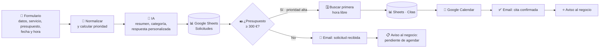
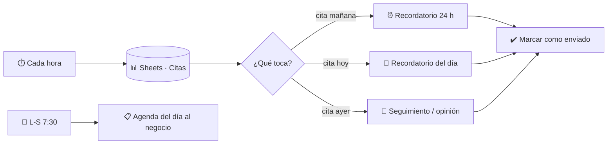

# ⚡ Gestión automática de solicitudes, citas y recordatorios con n8n

Sistema de automatización para un negocio de servicios que **recibe solicitudes de clientes, las prioriza según el presupuesto, agenda las citas y envía los recordatorios solo**, sin trabajo manual.

Lo construí pensando en algo que viví durante años gestionando una tienda: el tiempo que se pierde leyendo correos, apuntando citas a mano y llamando a la gente para recordárselas.

---

## 🧭 Qué hace





### Funcionalidades

| | Funcionalidad | Cómo |
|---|---|---|
| 📝 | **Formulario de solicitud** con nombre, email, teléfono, servicio, presupuesto, fecha y hora preferida | Form Trigger de n8n |
| 🤖 | **Análisis con IA**: resumen, categoría, complejidad y un párrafo personalizado para el cliente | OpenAI (`gpt-4o-mini`). Si la IA falla, el flujo sigue con textos por defecto |
| ⭐ | **Prioridad por presupuesto**: ≥ 300 € reciben cita al momento; el resto queda pendiente de agendar | Nodo IF |
| 🗓️ | **Gestor de citas sin solapes**: respeta horario (9–18 h), días laborables, antelación mínima de 2 h y citas ya ocupadas. Si la hora pedida está ocupada, asigna la siguiente libre y se lo explica al cliente | Nodo Code + pestaña `Citas` |
| 📆 | **Evento en Google Calendar** con los datos del cliente y el resumen de la IA | Google Calendar |
| ⏰ | **Recordatorio el día antes** con la fecha y la hora | Schedule Trigger cada hora |
| 📍 | **Recordatorio el mismo día** | Schedule Trigger cada hora |
| 💬 | **Seguimiento** al día siguiente de la cita pidiendo opinión | Schedule Trigger cada hora |
| 📋 | **Agenda diaria** al negocio (L–S a las 7:30) con las citas de hoy ordenadas | Schedule Trigger |
| ⚠️ | **Alertas de error**: si algo falla, llega un email con el paso y el error | Error Trigger |
| 🔁 | **Sin duplicados**: cada aviso se marca en la hoja y no se repite | Google Sheets (update) |

Las citas de clientes normales (menos de 300 €) se agendan añadiendo una fila en la pestaña `Citas` con Estado `Confirmada`. A partir de ahí reciben los mismos recordatorios que las prioritarias.

---

## 📁 Estructura

```
workflows/                         ← importar en n8n
  1-solicitudes-y-citas.json
  2-recordatorios-y-agenda.json
  3-alertas-de-error.json
src/nodos/                         ← código JavaScript de los nodos Code
scripts/generar-workflows.js       ← genera los .json a partir de src/
tests/logica.test.js               ← pruebas de la lógica (agenda, recordatorios…)
plantillas/                        ← cabeceras de las pestañas de Google Sheets
```

El código de los nodos vive en archivos `.js` para poder **probarlo y versionarlo** como cualquier proyecto de software; `npm run build` lo inserta en los workflows.

---

## 🚀 Puesta en marcha

1. **Google Sheets**: crea una hoja con dos pestañas, `Solicitudes` y `Citas`, y pega en la fila 1 las cabeceras de `plantillas/Solicitudes.csv` y `plantillas/Citas.csv`.
2. **Importa** los tres archivos de `workflows/` en n8n (*Workflows → Import from file*).
3. **Credenciales** en n8n: Google Sheets, Google Calendar, Gmail y OpenAI. Ábrelas en cada nodo que las pida.
4. Sustituye `PEGA_AQUI_EL_ID_DE_TU_GOOGLE_SHEET` por el ID de tu hoja (está en la URL, entre `/d/` y `/edit`) y `TU_CORREO@gmail.com` por el correo del negocio.
5. En los workflows 1 y 2: *Settings → Error workflow → 3 · Alertas de error*.
6. Activa los tres workflows.

Horario, duración de las citas y umbral de prioridad se cambian al principio de los nodos *Normalizar y calcular prioridad* y *Asignar hueco en la agenda*.

---

## 🧪 Pruebas

```bash
npm install
npm test
```

Las pruebas simulan el entorno de n8n con un reloj fijo y comprueban, entre otros casos:

- Prioridad con 300 € exactos, decimales con coma y presupuesto vacío.
- Asignación de la hora pedida cuando está libre, y de la siguiente libre cuando está ocupada.
- Citas canceladas que liberan su hueco.
- Peticiones en fin de semana, en fechas pasadas o a última hora del viernes.
- Recordatorio de 24 h, del mismo día y de seguimiento, sin repetir los ya enviados y sin enviar de madrugada.
- Fechas escritas a mano en la hoja (`05/11/2026`) y el cambio de hora de octubre.
- Respuesta de la IA caída sin romper el flujo.

---

Además, los tres workflows se importaron y ejecutaron en **n8n 2.45** con los servicios externos simulados (Sheets, Calendar, Gmail y OpenAI), comprobando las dos ramas del IF, la asignación de cita con la hora ocupada, los recordatorios, la agenda diaria y las alertas de error.

---

## 📌 Estado

- ✅ Workflows completos, validados en n8n y con la lógica cubierta por pruebas automáticas.
- 🔄 Conectando las credenciales reales de Google y OpenAI para la prueba de extremo a extremo.

## 🛠️ Tecnologías

n8n · JavaScript · Luxon · Google Sheets · Google Calendar · Gmail · OpenAI API · Git

---

**Erwin González Bonilla** · [Portafolio](https://portafolio-erwin.vercel.app/) · [LinkedIn](https://www.linkedin.com/in/erwingonzalezbonilla)
